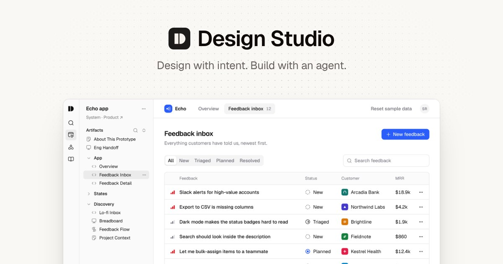
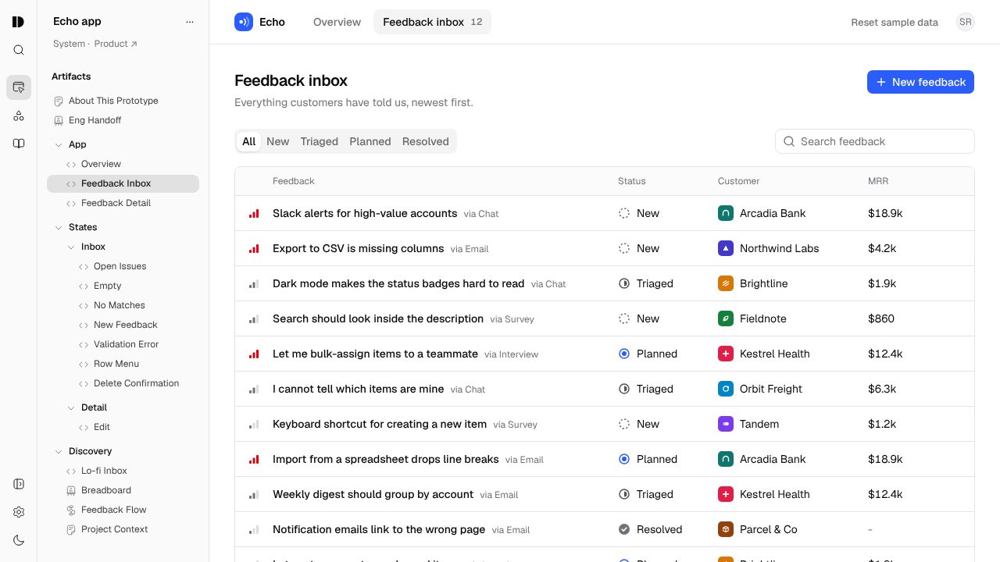

# Design Studio

An open-source, local prototype sandbox for designers and product managers who build with coding agents. Turn ideas into interactive prototypes, keep the thinking behind them close, and shape an environment that fits your team.

You direct the work in your preferred agent harness. Design Studio gives you a browser preview, reusable design systems, and a place to connect screens, diagrams, canvases, and documents. The code and context live together in a folder you own.

**[View demo](https://itspatmorgan.com/design-studio-demo/) · [Install Design Studio](src/platform/context/installing.md) · [See the product](https://itspatmorgan.com/design-studio)**

## What you can build

- **Interactive prototypes.** Explore onboarding, dashboards, settings, and other product flows. Build connected screens with states and simulated data that people can try in the browser.
- **Wireframes and alternatives.** Start with a rough layout, compare approaches, and refine the one you choose with your agent.
- **Diagrams and canvases.** Map a journey or system with Mermaid diagrams, sketch in Excalidraw, or arrange views, documents, and notes together on a canvas.
- **The thinking behind the work.** Keep briefs, assumptions, decisions, and open questions in Markdown documents alongside the prototype. You and your agent can read and edit the same files.
- **A foundation for your team.** Bring React components, theme, assets, product context, and instructions into a design system your agent can reuse across prototypes.

Use one artifact on its own or connect several to explain an idea. The included Product and Marketing systems and sample prototypes give you a starting point to explore, adapt, or replace.

<picture>
  <source media="(prefers-color-scheme: dark)" srcset="public/images/design-studio-product-dark.jpg">
  <source media="(prefers-color-scheme: light)" srcset="public/images/design-studio-product-light.jpg">
  
</picture>

The Echo app sample keeps working screens, alternate states, and project context together.

## Use the agent harness you already use

Design Studio does not supply its own coding agent. Open your Design Studio folder in an agent harness that can read files and run commands, such as Codex, Claude Code, or Cursor. Your agent follows the repository's `AGENTS.md` and linked instructions to configure the environment and build with you.

The working files use familiar formats: React and TypeScript for screens, Markdown for documents, Mermaid for diagrams, and Excalidraw for canvases. The starting stack is React, TypeScript, and Tailwind CSS. Ask your agent to assess your team's components and dependencies before bringing them in.

Design Studio is a front-end prototyping environment. You can simulate data and service behavior; connecting production services requires additional work.

## Get started

Install Design Studio in a `design-studio` folder on your computer, then open that folder in your preferred agent harness. A GitHub account is not required for local use.

The [installation guide](src/platform/context/installing.md) provides one set of steps you can run yourself or ask your agent to carry out:

> Install Design Studio from release v0.4.0 using https://github.com/itspatmorgan/design-studio/blob/v0.4.0/src/platform/context/installing.md. Use the repository installation guide without a plugin installer. Help me choose a folder, preserve existing files, and verify the running preview. Then help me open the Design Studio folder in my agent harness.

Once the folder is open, ask:

> Read AGENTS.md and help me configure my Design Studio. Start with the included examples and show me the running preview.

Explore the examples, then describe the idea you want to build. You can customize the design system and product context as your work develops.

## Own your copy and work together

Keep Design Studio locally or put it in your own private or company repository. You control access to that repository and decide when to take new Design Studio releases. The project does not need access to your environment. Ask your agent to help connect your repository and review updates; the [installation guide](src/platform/context/installing.md#keep-your-own-repository-and-choose-when-to-update) includes prompts for both.

You have the source code, so you can customize your own studio to fit your needs. Share what you build with the community so others can try it. See [Contributing](CONTRIBUTING.md) for community links and feedback.

Work individually in Personal mode, or use Team mode to register contributors and assign access within the local Design Studio. Teammates share source changes through Git. Engineers can inspect the prototype's code and supporting context when you hand off the work.

## Publish a viewing site

The ongoing public demo is included in the creator’s website deployment on GitHub Pages at [itspatmorgan.com/design-studio-demo](https://itspatmorgan.com/design-studio-demo/). ChatGPT Sites is an optional publishing-workflow demonstration. Teams can publish the same portable static viewing build with hosting services such as [Vercel](https://vercel.com/docs/frameworks/frontend/vite), [Netlify](https://docs.netlify.com/build/configure-builds/javascript-spas/), [Cloudflare](https://developers.cloudflare.com/workers/static-assets/), or another static-site host. Ask your agent to guide you through the host you use:

> Help me publish my Design Studio with [hosting service] so [audience] can explore it. Follow my Design Studio's publishing instructions and guide me through setting up hosting. Review what will be shared and verify the published link.

If you have not chosen a host, your agent can help you choose one. Reviewers can explore interactive prototypes and supporting material through the published link. You keep editing locally and publish again to share updates.

Private viewing access depends on your host's access controls. Design Studio does not provide built-in sign-in for published sites. See [Publishing](src/platform/context/publishing.md) for the build, routing, and visibility requirements your agent should follow.

## Documentation and feedback

Design Studio is in early beta. Feedback about installation, agent workflows, and prototyping helps improve the starting experience.

- [Manual](src/platform/modules/documentation/pages/index.md) — using and customizing Design Studio.
- [Modules](src/platform/context/modules.md) — extending its capabilities.
- [Ownership and updates](src/platform/context/ownership.md) — keeping your work as the platform changes.
- [Report an issue](https://github.com/itspatmorgan/design-studio/issues) — bugs, questions, and feature requests.
- [Contributing](CONTRIBUTING.md) — customize locally and share what works.
- [Changelog](CHANGELOG.md) — what's changed.

Created by **[Patrick Morgan](https://itspatmorgan.com)**. Follow the thinking behind the work at [Unknown Arts](https://www.unknownarts.com/).

## License

[MIT](LICENSE). Includes [Flexoki](https://stephango.com/flexoki) by Steph Ango (MIT) and [Pragmatic drag and drop](https://atlassian.design/components/pragmatic-drag-and-drop) by Atlassian (Apache-2.0).
