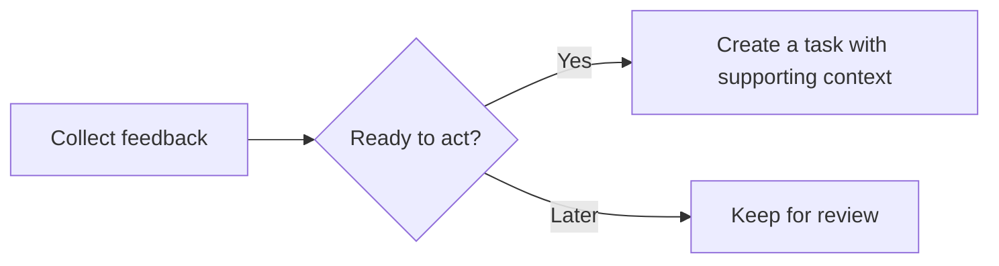
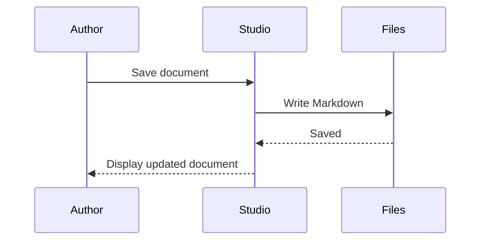
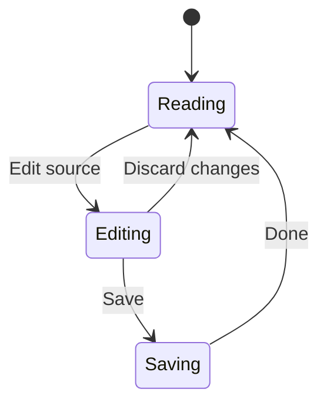
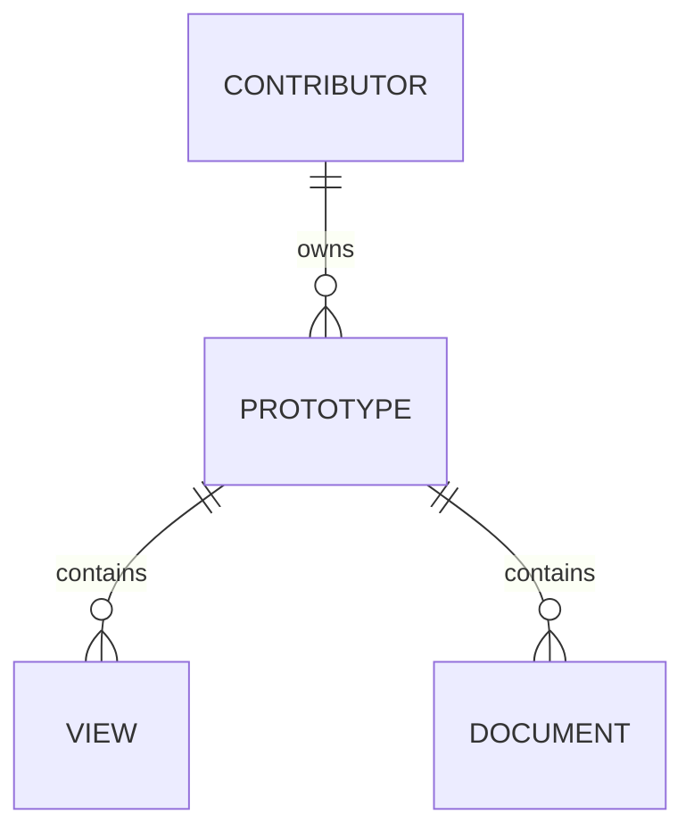
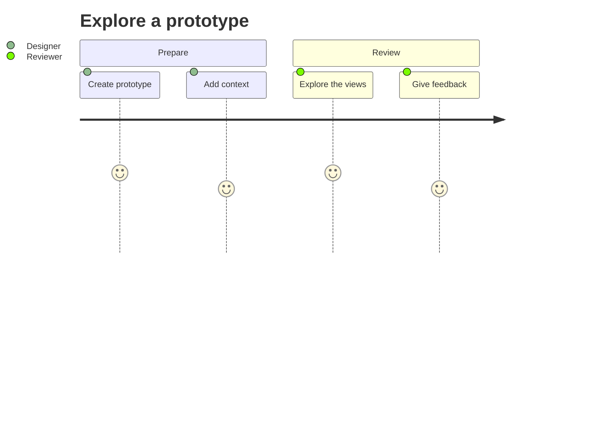
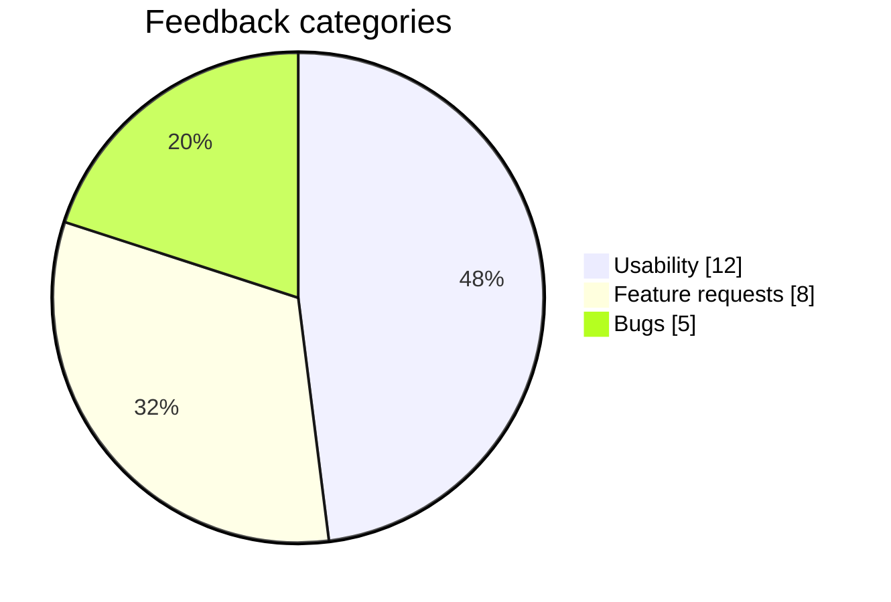
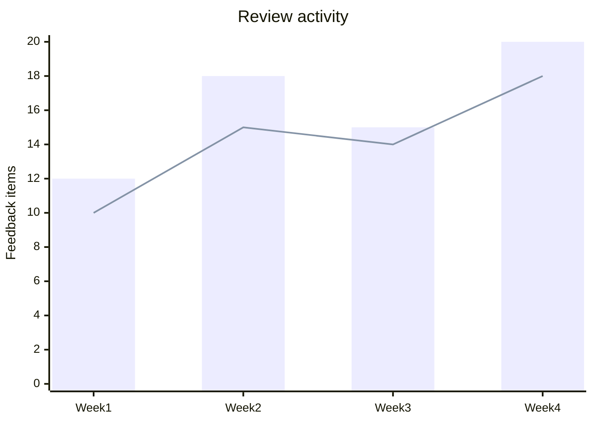

Mermaid blocks render automatically in the Manual, system context, reference pages, and prototype Documents. Write standard Mermaid syntax inside a fenced `mermaid` code block. Use the full view's source control to read or copy the diagram text.

The starter uses platform neutrals for structural diagrams and Flexoki accents for categories and chart series. Document code and the source editor share those accents. Change the platform's light or dark mode to preview both appearances.

Standalone prototype diagrams use the optional [Diagrams module](/documentation/context/module.diagrams). They share this renderer and theme; Markdown fences remain available when that module is disabled.

## Flowchart



## Sequence



## State



## Entity relationships



## User journey



## Categories

Color distinguishes categories. Labels preserve the meaning without relying on color alone.



## Chart series



## Document code

The same Flexoki color roles appear in highlighted code and the source editor. Language grammars can classify a token differently, so individual tokens may differ.

```ts
// Keep the next step explicit.
export function nextStep(actionable: boolean, count = 3) {
  const label = "Review feedback";
  return actionable ? { label, count } : null;
}
```

## Customize the defaults

Studio owners can edit `src/platform/systems/studio/styles/contentPalette.js` to change the shared accent palette and document syntax color roles. The source editor reads the same palette.

Edit `src/platform/app/diagrams/diagramTheme.ts` for diagram color roles and `MermaidDiagram.tsx` for renderer defaults. Diagram neutrals resolve from the platform's current CSS theme. The renderer keeps theme and security defaults under platform control. Authors can still use Mermaid's supported diagram styles, such as flowchart `classDef`, to communicate specific meaning.

Studio renders Mermaid source with Pele's lazy entry point, loading diagram types on demand. Source direction is preserved on every surface (`autoDirection: false`), while available width can change label wrapping and spacing. Fonts load before measurement; font changes and container resizing trigger remeasurement. Hidden zero-width panels wait until they become measurable. Canvas zoom scales the existing SVG rather than changing its layout. The standalone diagram page does the same: it starts fitted to the page, and **Zoom in**, **Zoom out**, and **Fit diagram** scale that SVG. Scrolling zooms toward the pointer, dragging pans, and the arrow keys move a zoomed view. Document fences and canvas previews stay fitted.

Host policy disables diagram links, images, JavaScript callbacks, and custom icon/math resolvers. Source configuration cannot enable them. Mermaid `classDef` and supported styles remain available, but arbitrary HTML labels, Mermaid themeVariables, external plugins, and layouts are not equivalent supported features. Keep standard Mermaid source portable and check the bundled Pele version's syntax support. Excalidraw uses its own rendering.

Rendering is bounded to 50,000 source characters, 500 flowchart edges, and 4,000,000 SVG characters. These limits do not impose a hard CPU deadline. Parsing, layout, and SVG generation are synchronous after the type loads; the asynchronous watchdog cannot interrupt that work.
